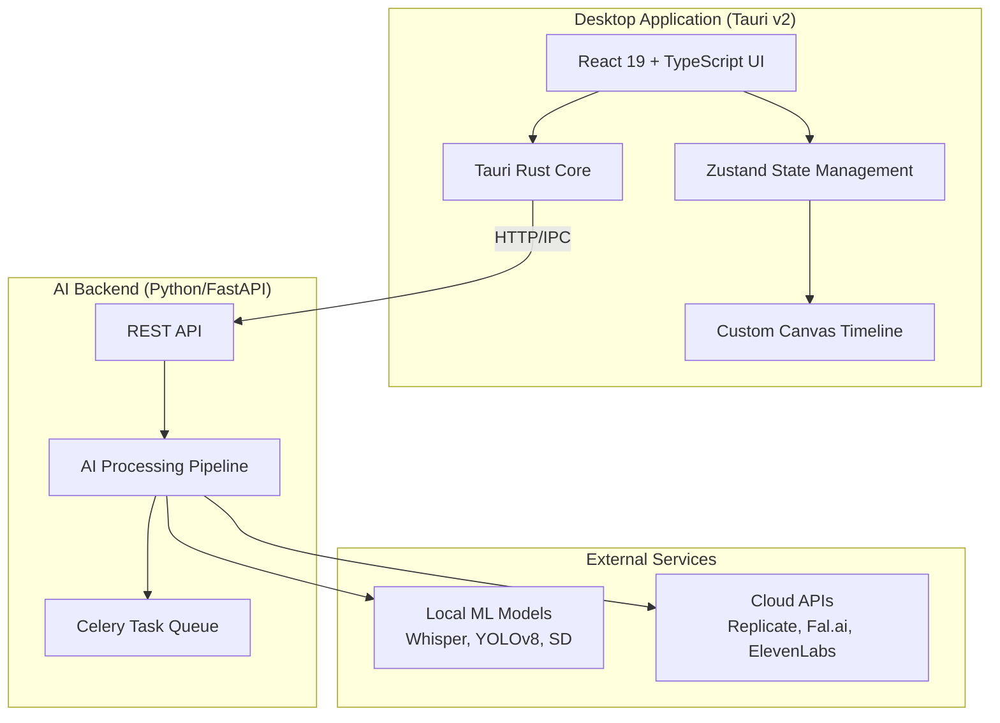

# AetherEdit Architecture

## System Overview



## Component Architecture

### Frontend (`apps/desktop`)

```
src/
├── components/         # React UI components
│   ├── MainLayout.tsx      # Resizable panel layout
│   ├── MenuBar.tsx         # Top menu bar
│   ├── Toolbar.tsx         # Edit tools toolbar
│   ├── MediaBrowser.tsx    # Media library panel
│   ├── ViewerSection.tsx   # Source/Program monitors
│   ├── Timeline.tsx        # Multi-track timeline
│   └── InspectorPanel.tsx  # Property inspector + AI chat
├── store/              # Zustand state management
│   └── appStore.ts         # Global application state
├── types/              # TypeScript interfaces
│   └── index.ts            # Clip, Track, Project, AIJob types
├── hooks/              # Custom React hooks
└── utils/              # Utility functions
```

**Key Technologies:**
- React 19 with TypeScript
- Tailwind CSS for styling
- Zustand + Immer for immutable state
- react-resizable-panels for layout
- Lucide icons
- Framer Motion for animations

### Backend (`apps/backend`)

```
apps/backend/
├── main.py             # FastAPI application
├── requirements.txt    # Python dependencies
└── README.md           # Setup instructions
```

**API Endpoints:**
- `POST /analyze` - Media analysis (scene detection, transcription, tagging)
- `POST /transcribe` - Audio to text with speaker diarization
- `POST /generate` - Text/image to video generation
- `POST /enhance` - Video enhancement (super-resolution, stabilization)
- `GET /jobs/{id}` - Job status polling
- `DELETE /jobs/{id}` - Cancel job

**AI Pipeline Stages:**
1. **Scene Detection** - PySceneDetect for shot boundaries
2. **Transcription** - Faster-Whisper for speech-to-text
3. **Object Detection** - YOLOv8-seg for objects/people
4. **Emotion Analysis** - CLIP-based emotion classification
5. **Quality Scoring** - ML model for clip quality assessment

### Tauri Core (`apps/desktop/src-tauri`)

```rust
// Commands exposed to frontend:
- greet(name: &str) -> String
- get_version() -> String
- (future) import_media(paths: Vec<String>) -> Result<Vec<ClipData>>
- (future) export_project(config: ExportConfig) -> Result<String>
```

## Data Flow

### Import Media Flow
```
User Drag-Drop → Tauri Dialog → File System → 
Backend Analyze Job → AI Processing → 
Metadata Store → Update Frontend State → Display in Media Browser
```

### Timeline Edit Flow
```
User Action (drag/trim) → Zustand Store (Immer) → 
Immutable State Update → React Re-render → 
Canvas Timeline Update → (optional) Backend Render Preview
```

### AI Assistant Flow
```
User Prompt → Context Serialization (timeline + selection) → 
Backend Chat API → LLM Planning → Execute Actions → 
Timeline Mutations → Undo Stack Push
```

## State Management

### Project State Structure
```typescript
interface Project {
  id: string;
  name: string;
  tracks: Track[];       // V1, V2, V3, A1, A2, A3...
  markers: Marker[];
  settings: ProjectSettings;
}

interface Track {
  id: string;
  type: 'video' | 'audio';
  clips: Clip[];
  muted: boolean;
  solo: boolean;
}

interface Clip {
  id: string;
  filePath: string;
  startTime: number;     // Position on timeline
  inPoint: number;       // Trim start
  outPoint: number;      // Trim end
  aiMetadata?: {
    sceneType?: string;
    objects?: string[];
    transcription?: Segment[];
  };
}
```

### Timeline State
```typescript
interface TimelineState {
  currentTime: number;
  zoom: number;
  selectedClipIds: string[];
  editMode: 'select' | 'ripple' | 'roll' | 'slip' | 'slide' | 'razor';
  isPlaying: boolean;
}
```

## Performance Optimizations

1. **Proxy Workflow**: Auto-generate 720p/1080p proxies for smooth playback
2. **Virtual Rendering**: Only render visible timeline clips + buffer
3. **Web Workers**: Offload heavy computations
4. **GPU Acceleration**: WebGL shaders for real-time effects
5. **Background Processing**: Non-blocking AI jobs with progress updates

## Security Model

- **Privacy-First**: All processing local by default
- **Explicit Consent**: Cloud AI only with user opt-in
- **Encrypted Storage**: Project files and API keys encrypted
- **Sandboxed Execution**: Tauri security features enabled

## Future Extensions

### Plugin System
```typescript
interface AIPlugin {
  id: string;
  name: string;
  process: (input: any) => Promise<any>;
  ui?: React.ComponentType;
}
```

### Collaboration Features
- Real-time multi-user editing (CRDT-based)
- Comment threads with @mentions
- Version history with diff view

### Advanced AI
- Script-to-edit agent
- Predictive editing suggestions
- Automatic highlight reel generation
- Multi-cam AI director
